<p align="center"></p>

<h1 align="center">Rigwright</h1>

<p align="center"><b>Set up, tune and repair Windows 10/11, with an AI assistant: fully local with Ollama, or Claude through Claude Code.</b><br>
Every change is previewed, recorded and reversible. The AI only suggests changes, and nothing runs until you approve it.</p>

<p align="center">


<a href="https://www.linkedin.com/in/joseph-mcginty-jr/"></a>
<a href="https://buymeacoffee.com/jcinc"></a>
</p>

<p align="center">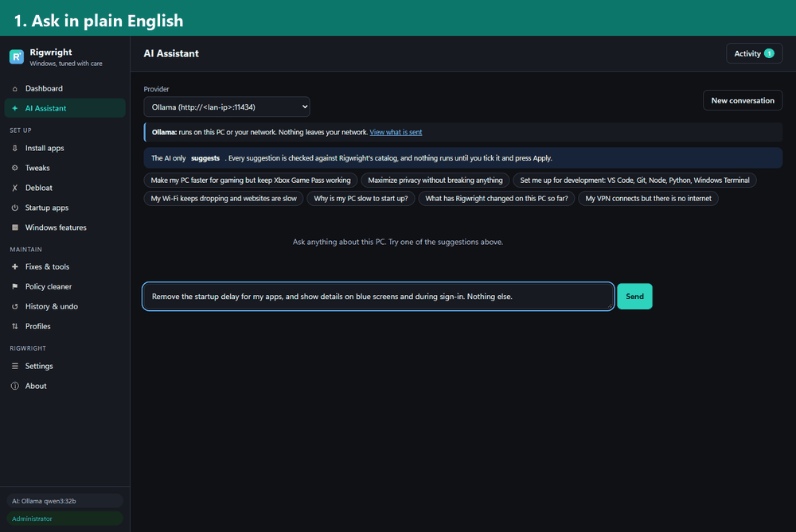</p>

---

## Easy download (no technical skills needed)

1. **[Download Rigwright for Windows](https://github.com/Subzero121800/RigWright/releases/latest/download/Rigwright-win-x64.zip)**. For Snapdragon / ARM laptops, get the [ARM64 version](https://github.com/Subzero121800/RigWright/releases/latest/download/Rigwright-win-arm64.zip) instead.
2. Right-click the downloaded file, choose **Extract All...**, then **Extract**.
3. Open the new **Rigwright** folder and double-click **Rigwright.exe**. Choose **Yes** when Windows asks for permission.

If Windows shows "Windows protected your PC", click **More info → Run anyway**. Nothing is installed, and you can delete the folder any time.

<details><summary>Prefer the command line? (winget / Git)</summary>

```powershell
# Option A - get the full app from source with Git (winget installs Git if you don't have it)
winget install --id Git.Git -e
cd ~\Downloads                      # any normal folder; not C:\Windows\System32
git clone --depth 1 https://github.com/Subzero121800/RigWright.git
cd RigWright
.\Start-Rigwright.cmd

# Option B - winget package (coming after 1.0; it will also be portable, no installer)
# winget install ResilientMindAI.Rigwright
```

Running from source starts the PowerShell edition in its own app window. `Rigwright.exe` is included in the release zips.
If the clone stops with `RPC failed; curl 92 HTTP/2 stream ... reset`, run `git config --global http.version HTTP/1.1` once and retry
(see [docs/TROUBLESHOOTING.md](docs/TROUBLESHOOTING.md)).
</details>

---

Rigwright is a free, open-source all-in-one Windows utility. It was built around the problems people report most with Windows tweak tools: undo that doesn't really undo, tweaks that quietly break Windows Update or VPNs, a window that freezes during long jobs, no way to see exactly what will change, and having to trust `irm | iex`.

On top of that, it adds an **AI assistant**. You describe what you want in plain English ("make this faster for gaming but keep Game Pass working", "my VPN connects but there's no internet") and get a reviewed, checkbox-by-checkbox plan. The assistant can use:

- **Ollama** on this PC, or on any machine on your LAN
- **Claude Code** (`claude -p`) on this PC
- **Claude Code on another PC on your LAN**, through the included bridge

## Contents

- [Easy download](#easy-download-no-technical-skills-needed)
- [Highlights](#highlights)
- [Screenshots](#screenshots)
- [Quick start](#quick-start)
- [Setting up the AI](#setting-up-the-ai)
- [What's inside](#whats-inside)
- [How Rigwright keeps you safe](#how-rigwright-keeps-you-safe)
- [Command line and automation](#command-line-and-automation)
- [Desktop app (.exe)](#desktop-app-exe)
- [Building a release](#building-a-release)
- [Project layout](#project-layout)
- [Documentation](#documentation)
- [Contributing, security and conduct](#contributing-security-and-conduct)
- [Support the project](#support-the-project)
- [License and credits](#license-and-credits)

## Highlights

| | |
|---|---|
| **Real undo** | Before changing anything, Rigwright records the exact original value: every registry value, service start type and scheduled task. Undo puts back what was really there, not a guessed "default". You can undo one tweak, a selection, or everything at once. Removed Store apps are different: they can be reinstalled from History, and deprovisioned apps return only after a reinstall. |
| **Exact preview** | "Show exact changes" lists every key, value, service and script, with current value → new value, before you apply. |
| **Live state and drift detection** | Each tweak shows *applied*, *not applied*, *partly applied* or *not for this PC*. If a feature update quietly reverts a tweak, Rigwright flags it as *reverted by Windows* and offers to reapply it. |
| **AI assistant** | Uses Ollama or Claude Code, local or on your LAN. It knows your hardware, what's already applied and your recent history. Every suggestion is checked against the catalog, and nothing runs without your approval. Custom commands are off by default; known-dangerous patterns are flagged and refused. With Ollama nothing leaves your network; with Claude, requests go to Anthropic. |
| **Never freezes** | All work runs in background jobs with a live Activity console. You can cancel jobs, and changes are queued so they never collide. |
| **Safe by design** | It refuses to disable Windows Update, Defender or Store services. It creates a restore point before changes and checks the OS build before applying. Tweaks that use Group Policy keys are labeled. |
| **Policy cleaner** | Fixes "Some settings are managed by your organization". It lists every policy value, marks which ones Rigwright set, and backs everything up before removing anything. |
| **No `irm \| iex`** | You download a release, verify its SHA-256 checksums, and run it locally. The UI is protected by a per-session token, single-use launch codes and DNS-rebinding protection. |

## Screenshots

<a href="https://subzero121800.github.io/RigWright/gallery.html"><picture><source media="(prefers-color-scheme: light)" srcset="docs/screenshots/gallery/slideshow-light.gif">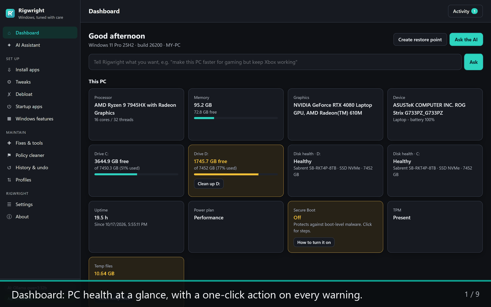</picture></a>

<p align="center"><sub>The slideshow cycles through nine pages and follows your GitHub theme (dark or light).
<b><a href="https://subzero121800.github.io/RigWright/gallery.html">Open the interactive gallery</a></b> to swipe or use the arrow keys, or open <code>docs/gallery.html</code> from a clone.</sub></p>

<details>
<summary><b>All nine pages as a grid</b> (with captions)</summary>

<picture><source media="(prefers-color-scheme: light)" srcset="docs/screenshots/gallery/light/01-dashboard.png">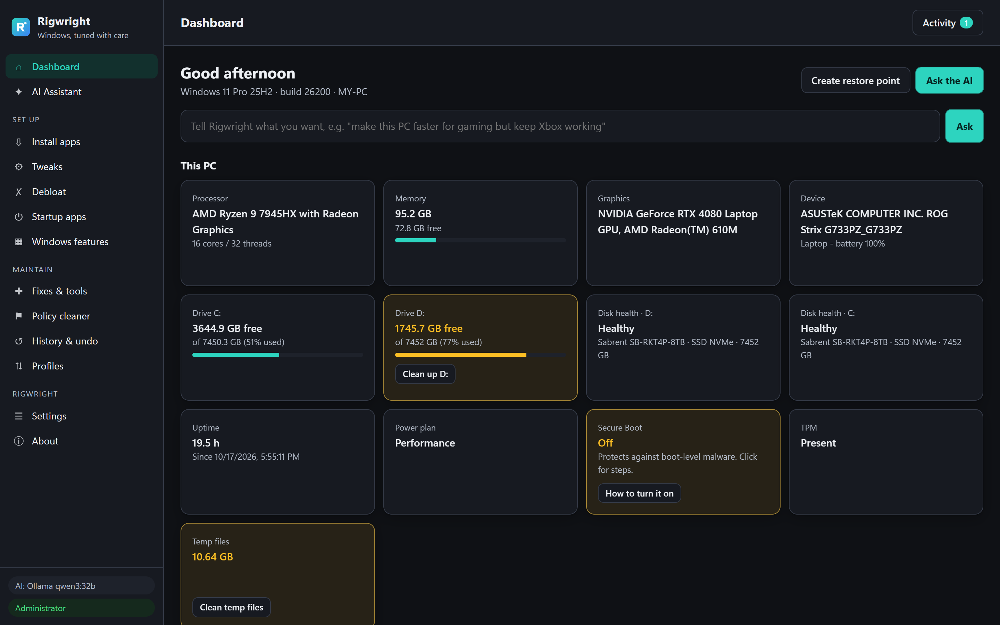</picture>

<p align="center"><sub><b>Dashboard</b>: PC health at a glance, with a one-click action on every warning.</sub></p>

<table>
<tr>
<td width="50%" valign="top"><picture><source media="(prefers-color-scheme: light)" srcset="docs/screenshots/gallery/light/04-tweaks.png">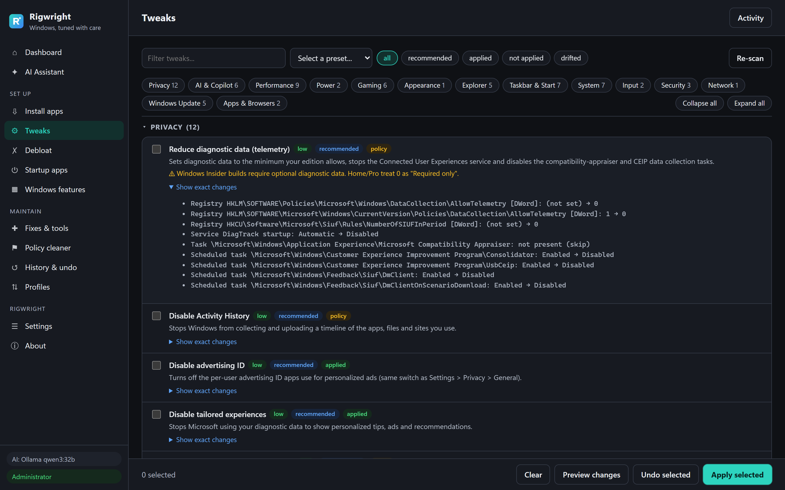</picture><br><sub><b>Tweaks</b> with live state. Every setting shows exactly what it changes.</sub></td>
<td width="50%" valign="top"><picture><source media="(prefers-color-scheme: light)" srcset="docs/screenshots/gallery/light/15-preview-modal.png">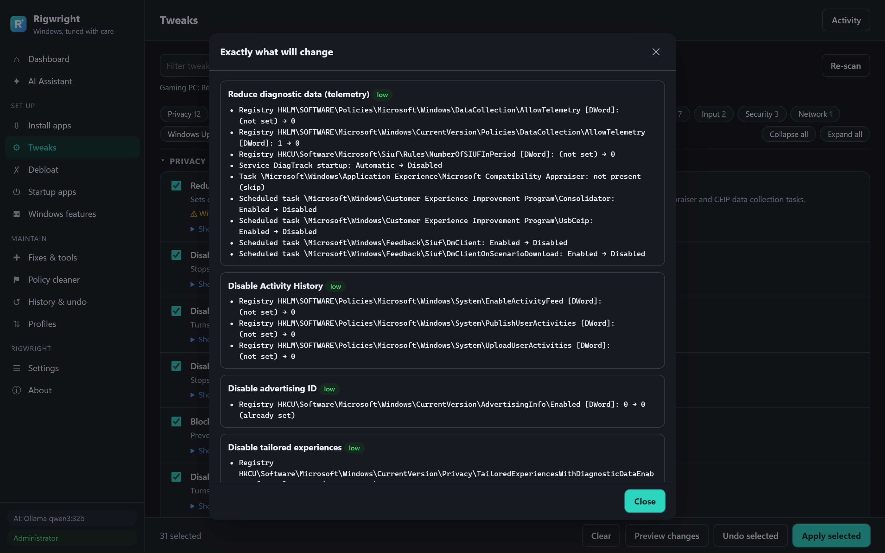</picture><br><sub><b>Preview before applying</b>: current value &rarr; new value, and a restore point first.</sub></td>
</tr>
<tr>
<td width="50%" valign="top"><picture><source media="(prefers-color-scheme: light)" srcset="docs/screenshots/gallery/light/17-ai-conversation.png">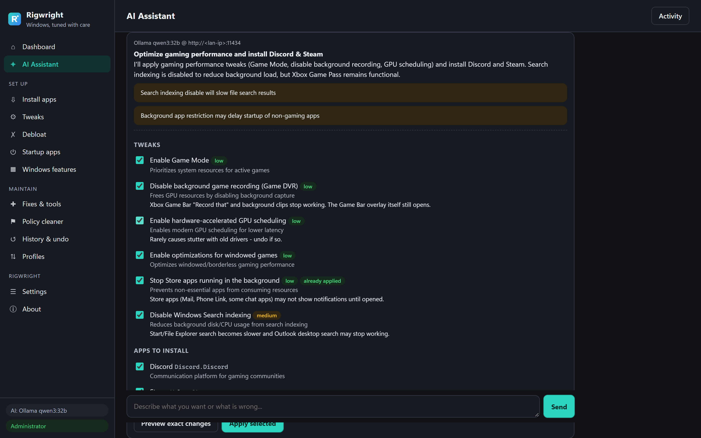</picture><br><sub><b>AI assistant</b> suggests a plan from the catalog; nothing runs until you approve.</sub></td>
<td width="50%" valign="top"><picture><source media="(prefers-color-scheme: light)" srcset="docs/screenshots/gallery/light/03-install-apps.png">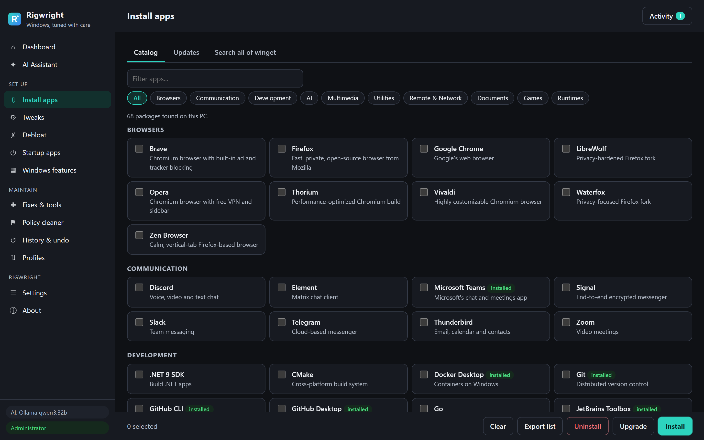</picture><br><sub><b>Install apps</b>: 127 curated apps via winget, sortable, plus search across all of winget.</sub></td>
</tr>
<tr>
<td width="50%" valign="top"><picture><source media="(prefers-color-scheme: light)" srcset="docs/screenshots/gallery/light/05-debloat.png">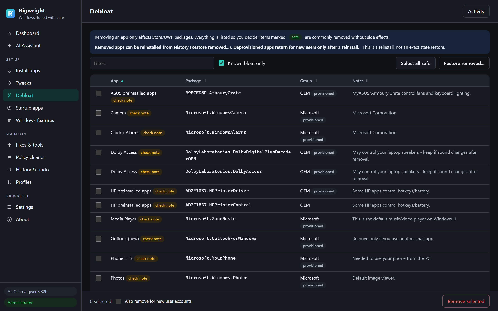</picture><br><sub><b>Debloat</b> lists what is really installed, with a safety rating for each app.</sub></td>
<td width="50%" valign="top"><picture><source media="(prefers-color-scheme: light)" srcset="docs/screenshots/gallery/light/08-fixes-and-tools.png">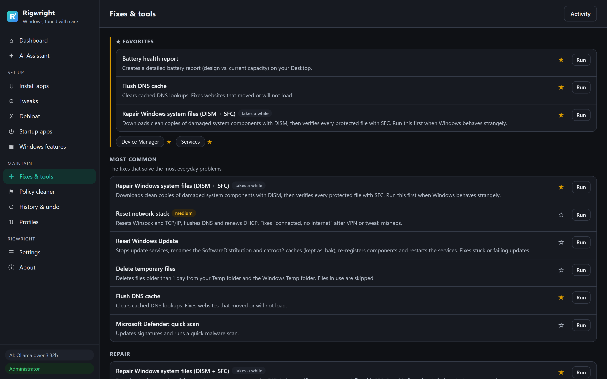</picture><br><sub><b>Fixes & tools</b> with Favorites and a Most common section at the top.</sub></td>
</tr>
<tr>
<td width="50%" valign="top"><picture><source media="(prefers-color-scheme: light)" srcset="docs/screenshots/gallery/light/10-history-and-undo.png">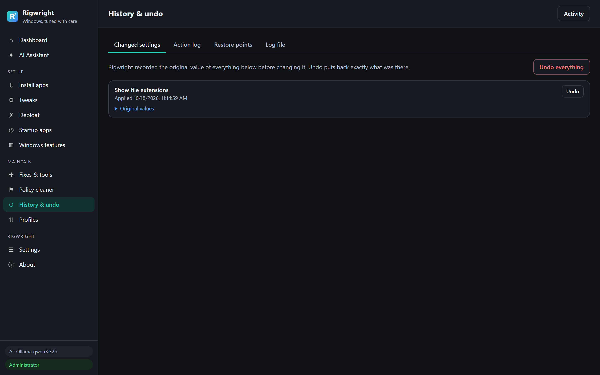</picture><br><sub><b>History & undo</b>: original values are recorded, so any change can be undone.</sub></td>
<td width="50%" valign="top"><picture><source media="(prefers-color-scheme: light)" srcset="docs/screenshots/gallery/light/12-settings.png">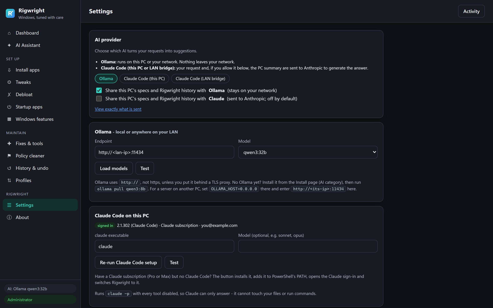</picture><br><sub><b>Settings</b>: Ollama or Claude Code, with clear per-provider privacy switches.</sub></td>
</tr>
</table>

</details>

<details>
<summary><b>In use:</b> removing 17 bloat apps in the desktop app</summary>

A restore point is created first, then each removal is logged live.

| Restore point first | Removing apps | Finished |
|---|---|---|
| 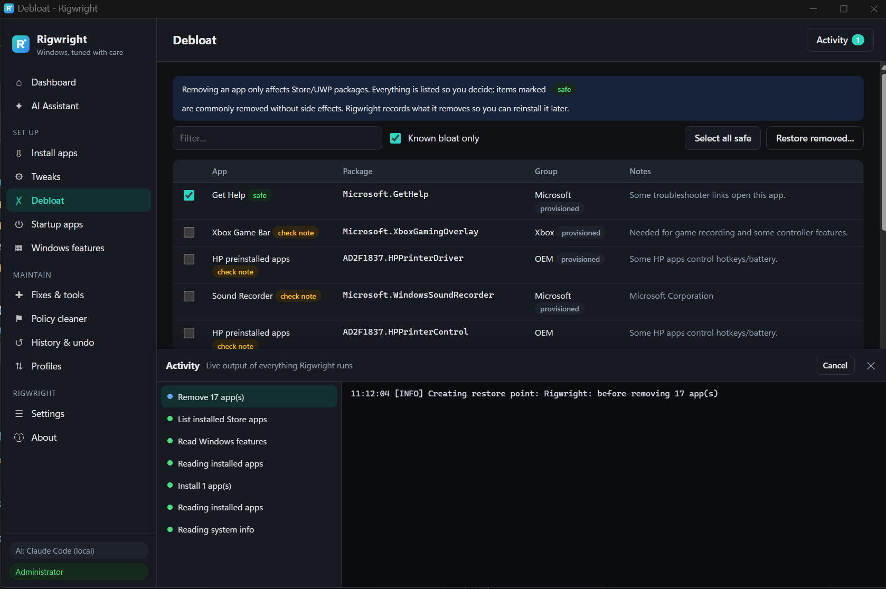 | 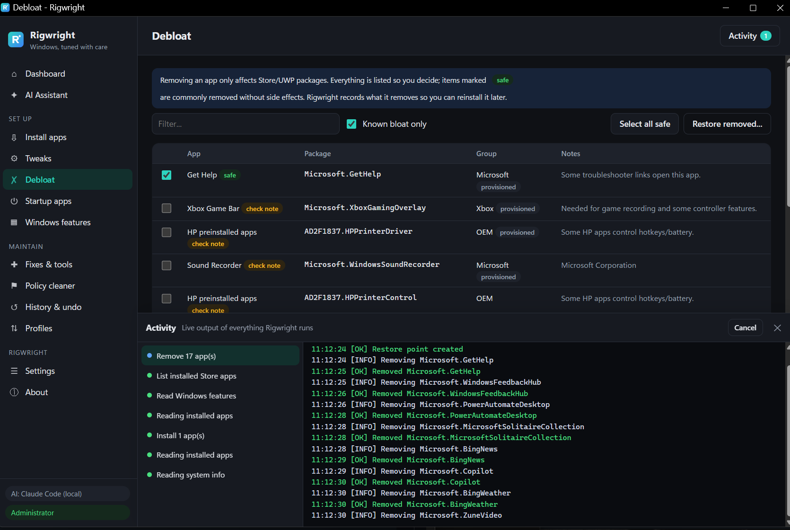 | 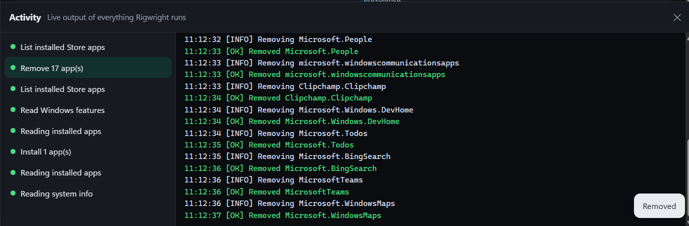 |

</details>

<details>
<summary><b>Every page, full length</b> (dark and light)</summary>

| Page | Dark | Light |
|---|---|---|
| Dashboard | [view](docs/screenshots/dark/01-dashboard.png) | [view](docs/screenshots/light/01-dashboard.png) |
| AI assistant | [view](docs/screenshots/dark/02-ai-assistant.png) | [view](docs/screenshots/light/02-ai-assistant.png) |
| Install apps | [view](docs/screenshots/dark/03-install-apps.png) | [view](docs/screenshots/light/03-install-apps.png) |
| Tweaks | [view](docs/screenshots/dark/04-tweaks.png) | [view](docs/screenshots/light/04-tweaks.png) |
| Debloat | [view](docs/screenshots/dark/05-debloat.png) | [view](docs/screenshots/light/05-debloat.png) |
| Startup apps | [view](docs/screenshots/dark/06-startup-apps.png) | [view](docs/screenshots/light/06-startup-apps.png) |
| Windows features | [view](docs/screenshots/dark/07-windows-features.png) | [view](docs/screenshots/light/07-windows-features.png) |
| Fixes & tools | [view](docs/screenshots/dark/08-fixes-and-tools.png) | [view](docs/screenshots/light/08-fixes-and-tools.png) |
| Policy cleaner | [view](docs/screenshots/dark/09-policy-cleaner.png) | [view](docs/screenshots/light/09-policy-cleaner.png) |
| History & undo | [view](docs/screenshots/dark/10-history-and-undo.png) | [view](docs/screenshots/light/10-history-and-undo.png) |
| Profiles | [view](docs/screenshots/dark/11-profiles.png) | [view](docs/screenshots/light/11-profiles.png) |
| Settings | [view](docs/screenshots/dark/12-settings.png) | [view](docs/screenshots/light/12-settings.png) |
| About | [view](docs/screenshots/dark/13-about.png) | [view](docs/screenshots/light/13-about.png) |
| Tweak exact changes | [view](docs/screenshots/dark/14-tweak-exact-changes.png) | [view](docs/screenshots/light/14-tweak-exact-changes.png) |
| Preview dialog | [view](docs/screenshots/dark/15-preview-modal.png) | [view](docs/screenshots/light/15-preview-modal.png) |
| Activity console | [view](docs/screenshots/dark/16-activity-console.png) | [view](docs/screenshots/light/16-activity-console.png) |
| AI conversation | [view](docs/screenshots/dark/17-ai-conversation.png) | |

</details>

To regenerate: `python tools/capture_screenshots.py` (full-length pages), `python tools/capture_screenshots.py --gallery`
(the window-sized images above) and `python tools/make_gallery_slideshow.py` (the slideshow GIFs). The capture scripts need
`pip install playwright`; run them elevated for complete data. Private IPs,
email addresses and user names are scrubbed from every capture.
## Quick start

> **Rigwright itself installs nothing:** no installer, no services, nothing left running when you close it. App installs use winget, and the AI is optional.

**Requirements:** Windows 10 21H2+ or Windows 11 (x64 or ARM64), with Windows PowerShell 5.1 (built in). Release builds of `Rigwright.exe` are self-contained, so no .NET install is needed. Installing apps uses **winget**; if winget is missing, Rigwright offers to install it.

1. Download the zip for your PC from GitHub Releases (`Rigwright-<version>-win-x64.zip` or `-win-arm64.zip`) and extract it, for example to `C:\Tools\Rigwright`.
2. *(Recommended)* Verify the download:
   ```powershell
   powershell -ExecutionPolicy Bypass -File .\tools\Verify-Release.ps1
   ```
3. Start it using one of these:
   - Double-click **`Rigwright.exe`**, the desktop app. If the WebView2 runtime is missing, it opens Rigwright in your browser instead.
   - Double-click **`Start-Rigwright.cmd`**, the PowerShell edition, which opens in its own window.
   - Run `.\Rigwright.ps1` from PowerShell.
4. Approve the administrator (UAC) prompt. Only the engine runs elevated; the window itself runs as you.

The launchers start the engine with `-ExecutionPolicy Bypass` for that one process only, so Rigwright also runs from a USB stick, a network share or a mapped drive. `tools\Verify-Release.ps1` checks the checksums and, on signed releases, the Authenticode signatures.

**Portable mode.** By default, settings, the undo journal and logs live in `C:\ProgramData\Rigwright`, so undo keeps working even if you delete or move the Rigwright folder. Start with `-Portable` (`Start-Rigwright.cmd -Portable`) to keep everything in `.\data` beside the app instead. In that case the undo history travels with the folder. **Settings → Rigwright data** can add a Start menu shortcut or remove all Rigwright data from this PC.

When you close the window, the engine stops. Settings, the journal and logs live in `C:\ProgramData\Rigwright`.

## Setting up the AI

Open **Settings → AI provider** and choose one of the options below.

### Ollama (free, fully local)

1. Install Ollama. It's on Rigwright's **Install** page under *AI*, or run `winget install Ollama.Ollama`.
2. Pull a model that follows instructions well, for example:
   ```powershell
   ollama pull qwen3:8b        # good default (8 GB+ RAM)
   ollama pull qwen3:14b       # better reasoning (16 GB+ RAM or 12 GB VRAM)
   ollama pull llama3.1:8b     # alternative
   ```
3. In Settings, click **Load models**, pick the model, then click **Test**.

**Ollama on another PC (LAN):** on that PC, set the environment variable `OLLAMA_HOST=0.0.0.0` and restart Ollama. Allow TCP 11434 through its firewall on Private networks. Then enter `http://<that-pc-ip>:11434` as the endpoint here.

### Claude Code on this PC

**One click (Claude subscription, no Claude Code yet):** open **Settings → Claude Code on this PC** and press **Install & connect Claude Code**. (The Dashboard offers the same button while no AI is set up.) Rigwright then:

1. Installs Claude Code from the official winget package `Anthropic.ClaudeCode`.
2. Adds it to your PATH, so `claude` works in any new PowerShell window.
3. Opens the Claude sign-in (`claude auth login --claudeai`). Log in with your Pro or Max subscription.
4. Waits until `claude auth status` reports you are signed in, switches Rigwright to Claude Code and runs a test.

**Manual:** install [Claude Code](https://claude.com/claude-code), run `claude` once to sign in, then choose **Claude Code (this PC)** in Settings and click **Test**.

> **Privacy:** with Claude Code (here or through the LAN bridge), your request is sent to **Anthropic** to generate the answer. Your PC summary and Rigwright history are sent only if you turn on *Share this PC's specs and Rigwright history with Claude*, which is off by default. **View exactly what is sent** in Settings shows the full context. Only Ollama keeps everything on your network.

Rigwright runs `claude -p --tools ""` with structured JSON output. **All tools are disabled**, so Claude can answer but cannot read files or run anything. The cost of each request is shown next to the answer. To use a lighter model for routine requests, set *Model* to `sonnet`.

### Claude Code on another PC (LAN bridge)

On the PC that has Claude Code installed (Windows, macOS or Linux):

```powershell
# copy the "bridge" folder over, then:
.\claude-bridge.ps1                 # Windows PowerShell or pwsh
pwsh ./claude-bridge.ps1            # macOS / Linux
```

The bridge prints a URL and a token. In Rigwright, choose **Claude Code (LAN bridge)**, paste both, and click **Test**. Bridge options:

| Option | What it does |
|---|---|
| `-Port 9000` | Listens on a different port. |
| `-AllowFrom 192.168.1.20` | Accepts requests only from that IP address. |
| `-ShowToken` | Prints the current token. |
| `-RotateToken` | Replaces the token with a new one. |

On Windows, the first run prints two one-time admin commands: a URL reservation and a firewall rule. More detail is in [docs/AI.md](docs/AI.md).

## What's inside

| Page | What it does |
|---|---|
| **Dashboard** | Hardware, drives and disk health, uptime, temp files, power plan, Secure Boot/TPM. It also shows alerts for reverted tweaks and missing winget, plus quick actions. |
| **AI Assistant** | Chat that returns a reviewable plan: tweaks to apply or revert, apps, fixes, Windows features and (optional) custom commands. |
| **Install apps** | 127 curated apps in 11 categories, all winget IDs verified. Shows which are installed and lets you install, uninstall or upgrade. Has an **Updates** tab and **search across all of winget**. Falls back to Chocolatey, and supports per-app installer arguments (e.g. Battle.net). |
| **Tweaks** | 68 tweaks across 14 categories: Privacy, AI & Copilot, Performance, Power, Gaming, Explorer, Taskbar & Start, System, Security, Network, Windows Update and more. Each shows its risk, live state and side effects, plus an exact preview. Six presets: Recommended, Gaming PC, Maximum privacy, Work laptop, Old/slow PC, Developer. |
| **Debloat** | Lists your actual installed Store apps, with 72 known-bloat entries rated *safe* or *check note*. Can optionally deprovision for new users. Records removals so you can restore them. |
| **Startup apps** | Turns startup entries on or off using the same mechanism Task Manager uses. |
| **Windows features** | WSL, Hyper-V, Sandbox, .NET 3.5, NFS, legacy DirectPlay, OpenSSH server/client and more, with live state. |
| **Fixes & tools** | 28 one-click repairs: DISM+SFC, Windows Update reset, network reset, DNS presets, deep cleanup, winget repair, Defender quick/full/offline scans, time sync, icon cache, print queue, audio, WMI, driver backup, battery report and more. Also 26 classic Windows tools one click away. |
| **Policy cleaner** | Finds and removes leftover Group Policy values (the "managed by your organization" banner), with an automatic `.reg` backup first. |
| **History & undo** | Shows the original values of everything changed, with per-item undo or **Undo everything**. Also: action log, restore points, a registry backup, and log viewer/export plus a system report. |
| **Profiles** | Export or import your selections as JSON, with a dry run before applying. The same files drive the command line. |
| **Settings** | AI providers, safety switches, LAN access with one-time links, and theme. |

## How Rigwright keeps you safe

- **State-capture journal.** The first time a tweak is applied, its original state is saved to `journal.json`. Undo restores from that record.
- **Restore point first.** A restore point is created before every batch of changes. Windows' 24-hour limit on restore points is lifted only for that call.
- **Protected services.** Rigwright will never disable `wuauserv`, `WaaSMedicSvc`, `UsoSvc`, `BITS`, Defender, the Store services, or about a dozen other core services, even if a tweak or the AI asks.
- **OS-aware.** Tweaks declare `minBuild`/`maxBuild` and are greyed out where they don't apply.
- **Honest labels.** Every tweak has a risk level and, where relevant, its side effects. Policy-based tweaks are badged so the "managed by your organization" message is never a surprise.
- **AI guard rails.**
  - Suggestions are matched to catalog IDs, and unknown IDs are dropped.
  - Apps that aren't in the catalog are flagged *verify* and left unticked.
  - Custom commands are **off by default**. When enabled, each one is shown in full in a separate "Unvetted command (not from the catalog)" section and is never ticked for you.
  - Known-dangerous and obfuscated patterns are flagged and refused. This includes disk formatting, partitioning, deleting System32, shadow-copy deletion, `-EncodedCommand`, `iex`, `[scriptblock]::Create`, `Add-Type`, downloads and commands whose name is built at runtime. The check parses the command with PowerShell's own parser and runs again on the server right before execution. It is a filter, not a sandbox: no filter can catch everything, so review every custom command.
- **High-risk confirmation.** If a selection contains medium- or high-risk items, you get a summary to confirm. For high risk you can optionally be required to type `APPLY`.
- **Local-only server.** The server binds to `127.0.0.1`, checks the `Host` header, needs a random 256-bit session token on every API call, and hands out the token only in exchange for single-use, 5-minute launch codes. LAN mode is opt-in, limited to Private network profiles, and still token-protected. See [SECURITY.md](SECURITY.md).

## Command line and automation

```powershell
.\Rigwright.ps1                          # GUI (app window)
.\Rigwright.ps1 -Browser                 # GUI in your default browser
.\Rigwright.ps1 -Lan                     # also allow devices on your private network
.\Rigwright.ps1 -Config .\setup.json -DryRun   # show exactly what a profile would do
.\Rigwright.ps1 -Config .\setup.json -Run      # apply it unattended (exit code 0 = success)
.\Rigwright.ps1 -Version
```

A profile is plain JSON. Create one from the **Profiles** page, or write it by hand:

```json
{
  "format": "rigwright-profile",
  "version": 1,
  "name": "Family PC",
  "tweaks": ["privacy.telemetry", "privacy.suggestions", "ui.fileExtensions", "sec.pua"],
  "apps": ["Mozilla.Firefox", "7zip.7zip", "VideoLAN.VLC"],
  "features": []
}
```

## Desktop app (.exe)

`desktop/` contains a small C#/.NET 9 WinForms + WebView2 shell (`Rigwright.exe`). It runs unelevated, starts the elevated engine, and shows the UI in a native window. Links to other sites open in your browser, and closing the window stops the engine.

```powershell
cd desktop
dotnet build -c Release          # needs the .NET 9 SDK
```

## Building a release

```powershell
.\tools\Build-Release.ps1                       # tests + self-contained x64 and arm64 zips + SHA256SUMS
.\tools\Build-Release.ps1 -FrameworkDependent   # smaller exe that needs the .NET 9 Desktop Runtime
.\tools\Build-Release.ps1 -SkipDesktop          # PowerShell edition only
.\tools\Publish-Release.ps1                     # upload to GitHub Releases (needs: gh auth login)
.\tools\New-WingetManifest.ps1                  # winget portable manifest for the published release
```

**Code signing** (avoids SmartScreen's "unknown publisher" warning). Rigwright.exe and every `.ps1`/`.psm1` are
Authenticode-signed before checksums are written:

```powershell
.\tools\Build-Release.ps1 -SelfContained -CertThumbprint <thumbprint>          # certificate in your Windows cert store
.\tools\Build-Release.ps1 -SelfContained -AzureSigningMetadata .\metadata.json `
                          -AzureSigningDlib <path>\Azure.CodeSigning.Dlib.dll  # Azure Artifact Signing
```

`tools\Verify-Release.ps1` checks the checksums and every signature. Unsigned builds still verify by checksum.

Tests on their own:

```powershell
.\tests\Test-Catalog.ps1           # schema, ids, presets, script syntax, ASCII check
.\tests\Test-Catalog.ps1 -Winget   # also verify every app id exists in winget
.\tests\Test-Server.ps1            # end-to-end API and security smoke test (no system changes)
```

## Project layout

```
Rigwright/
├─ Rigwright.ps1            launcher, server entry point and headless CLI
├─ Start-Rigwright.cmd      double-click launcher
├─ core/
│  ├─ Engine.psm1           tweaks, journal/undo, apps, features, fixes, debloat, startup, policies
│  ├─ AI.psm1               Ollama / Claude Code providers, prompt building, validation and guard rails
│  └─ Server.psm1           HTTP server, auth, background jobs
├─ catalog/                 tweaks, apps, fixes, features, debloat, presets (JSON - easy to contribute to)
├─ web/                     UI (vanilla HTML/CSS/JS, strict CSP, no external requests)
├─ bridge/claude-bridge.ps1 Claude Code LAN bridge (Windows/macOS/Linux)
├─ desktop/                 optional C# WebView2 shell (Rigwright.exe)
├─ tests/                   catalog and server tests
├─ tools/                   release build and verification
└─ docs/                    architecture, AI, tweak schema, comparison, troubleshooting, privacy
```

## Documentation

- [docs/ARCHITECTURE.md](docs/ARCHITECTURE.md): how the pieces fit together
- [docs/AI.md](docs/AI.md): providers, models, the bridge, prompts and guard rails
- [docs/TWEAK-SCHEMA.md](docs/TWEAK-SCHEMA.md): how to write a tweak, app, fix or preset
- [docs/COMPARISON.md](docs/COMPARISON.md): the problems with typical Windows tweak tools and how Rigwright handles each one
- [docs/TROUBLESHOOTING.md](docs/TROUBLESHOOTING.md): common problems and fixes
- [docs/PRIVACY.md](docs/PRIVACY.md): what data goes where, per AI provider
- [docs/GOVERNED-AGENTS.md](docs/GOVERNED-AGENTS.md): *Governed agents on the desktop: the Rigwright pattern*. The AI proposes, a catalog validates, a human approves and a journal rolls back.
- [CHANGELOG.md](CHANGELOG.md)

## Contributing, security and conduct

Contributions are welcome. New tweaks and apps are just JSON. Please read [CONTRIBUTING.md](CONTRIBUTING.md) and follow the [Code of Conduct](CODE_OF_CONDUCT.md). To report a vulnerability privately, see [SECURITY.md](SECURITY.md).

> **Disclaimer.** Rigwright changes system settings. It is designed to be cautious and reversible, but use it at your own risk, especially on work or school PCs managed by an organization. Keep backups.

## Support the project

Rigwright is free and always will be. If it saved you time, you can
**[support Joseph C McGinty Jr. on Buy Me a Coffee](https://buymeacoffee.com/jcinc)**. Thank you! Questions, ideas or feedback: [GitHub Discussions](https://github.com/Subzero121800/RigWright/discussions) or [connect on LinkedIn](https://www.linkedin.com/in/joseph-mcginty-jr/).

## License and credits

**Created by Joseph C McGinty Jr. & ResilientMind AI LLC.** Connect on [LinkedIn](https://www.linkedin.com/in/joseph-mcginty-jr/).
Copyright © 2026 Joseph C McGinty Jr. & ResilientMind AI LLC. Released under the [MIT License](LICENSE).

Informed by the approaches of O&O ShutUp10++, Win11Debloat, Sophia Script, privacy.sexy and UniGetUI. Rigwright is an independent project, not affiliated with or endorsed by Microsoft, Anthropic or Ollama. Windows is a trademark of Microsoft Corporation. Claude and Claude Code are trademarks of Anthropic, PBC. Ollama is a trademark of its respective owner.
